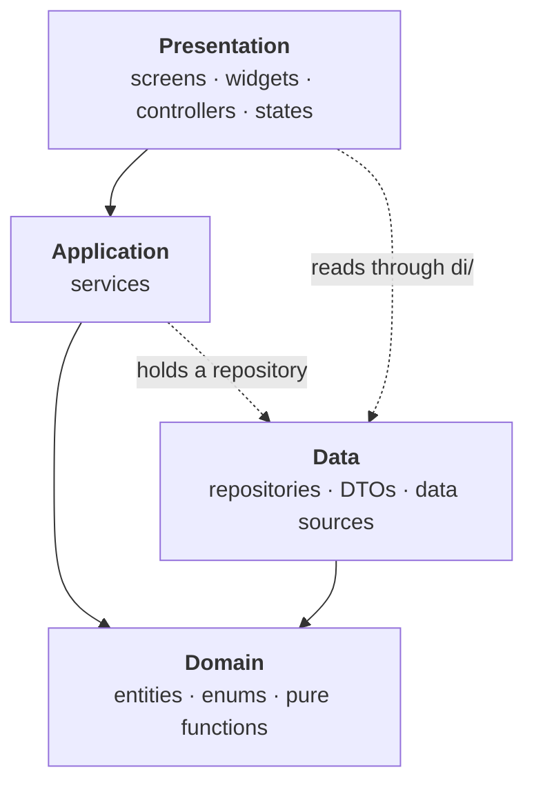

# Architecture

How this codebase is arranged, and why. The mechanical half of this document is
`test/architecture/layer_boundaries_test.dart`, which reads every import line in `lib/`
and fails the suite when one crosses a boundary. What follows is the reasoning those
rules encode — read this first, and treat the test as the authority on the exact letter.

## The four layers

Each feature is a module under `lib/modules/`, and each module is laid out on the same
four layers. A layer may use the layer below it and never the one above.



**Domain** is the problem, in plain Dart. Entities, enums, and pure functions — a proxy
config, a connection status, a version comparison. It imports nothing but other domain
files: no Flutter, no Riverpod, no Dio, no `dart:io`. That is what makes it the one layer
you can read to learn what the app is about, and the one layer that tests need no setup to
exercise.

**Data** talks to the outside world — the Begzar API, secure storage, the platform
channel into the proxy engine. A repository returns domain types, so the layers above
never see a wire format. DTOs do the translating and stay inside this layer. A repository
takes its dependencies as constructor parameters and never reads a provider.

**Application** is the behaviour that is not one repository call: a service sequences
several, applies a rule, and decides what the answer is. `ConnectionService` testing
configs in order until one dials is application; the platform call it makes each time is
data.

**Presentation** is what the user sees and touches, plus the controllers driving it. A
`Notifier` holds a state class, calls a service, and folds the result into something a
widget can render. Nothing below presentation may import it.

Not every module earns every layer. `main` is a screen over other modules' state — it has
no data of its own. `notifications` has nothing to model, so it has no domain. A missing
folder is a statement that the module has nothing to put there, not an omission to be
corrected.

## The rules, and the reason each carries

Seven rules run over every import in `lib/`. Each is stated here with what it protects;
the wording in the test is the enforceable version.

| Rule | What it forbids | Why |
|---|---|---|
| `domain-is-pure` | Domain importing Flutter, Riverpod, Dio, `dart:io`, `dart:ui` | Domain models the problem. A domain file that needs a widget test to run has stopped being one. |
| `domain-imports-only-domain` | A domain file importing any non-domain file | Reaching sideways into `core/` or another layer is how import cycles start. |
| `data-below-presentation` | Data importing presentation | Data sits below presentation and must never know it exists. |
| `data-has-no-container` | A repository or data source importing Riverpod | It takes its inputs as constructor parameters. Reading a provider couples it to whichever module declared that provider, and makes it untestable without one. |
| `application-below-presentation` | Application importing presentation | Same direction as data. A service that watches a notifier cannot be run without a container. |
| `core-has-no-feature-deps` | `lib/core/` importing `lib/modules/` | Importing a feature from the floor inverts the dependency and makes core a sibling rather than a floor. |
| `app-shell-is-a-leaf` | Anything importing `lib/app/` | The shell composes modules, so it depends on all of them. That only holds while nothing depends on it back. |

## The two things that are not layers

**`lib/core/` is the floor.** Security, the API client, storage, theme, shared widgets —
what every module stands on. It may not import a module. When core appears to need a type a
module owns, the answer is never to reach upward; see
[When the floor wants something a module owns](#when-the-floor-wants-something-a-module-owns)
for the four shapes that turned out to be.

**`lib/app/` is the shell.** Routing, startup, lifecycle. It is the one place allowed to
depend on every module, because composing them is its whole job, and nothing may depend on
it back.

Between them the dependency graph has one shape: modules sit on core, the shell sits on
modules, and nothing points back up.

## Where the wiring lives

Providers are declared in two places, and which one depends on what is being wired.

**Beside its notifier.** A `Notifier` and the provider that exposes it are one unit —
`connectionProvider` is declared at the bottom of `connection_notifier.dart`, and every
controller in the app follows that. Splitting them puts two files in every diff that
touches one idea.

**In the module's `di/`.** Everything below presentation — repositories, data sources,
services — is wired in a module-root `di/` file. These are the seams: a test builds a
`ProviderContainer` and overrides `connectionRepositoryProvider` with a fake, leaving the
real service and controller graph in place.

A `di/` file may hold a small helper that gathers what a provider needs (see
`_readTunnelOptions` in `connection/di/`), but it holds no behaviour of its own. A module
with nothing below presentation to wire has no `di/`, which is why several do not.

**A `ref.listen` belongs on the notifier, not in a widget's `build`.** Written inside a
`ConsumerState.build` it only runs while that widget is mounted, which quietly makes it a
listener for *some* of the events it names. `PremiumServersNotifier` watches the connection
from its own `build` for that reason: a connect can land while the premium list is nowhere
on screen, and quick connect — started from the home dial — always does. The version that
lived in the list widget missed every one of those, which is why the last-connected badge
could point at a server the user had not been on for days.

**A long-lived service is owned by a provider, not by a static.** Several of these were
singletons that anything could reach for — the ad manager, the banner prewarmer, the
post-connect ad gate, the ad-gate flag store, analytics. Holding state for the app's whole
run is a fine reason to be long-lived and no reason at all to be unreachable: a static has
no seam, so a test cannot swap it and has to reset it between cases instead. Each is a
`Provider` now, which is the same lifetime with a seam in it. `AnalyticsService` still has
a factory returning one instance, because it wraps a Firebase singleton; what matters is
that the one construction in `lib/` happens inside its provider. The banner disk cache is
reached the same way: `adBannerCacheProvider` hands the prewarmer and the overlay one
instance, so the overlay reads the cache the prewarmer filled, and a test can fail a
download.

**A provider a test does not override is a live dependency, not a default.** A
`ProviderContainer` replaces the seams the test names and leaves every other one real, so a
provider the code under test can reach and the container did not override is the production
object. `connect_tap_test` overrode both repositories and left `apiV2ServiceProvider` alone;
the one test that takes the free path called the live Begzar API on every run, from whatever
network the machine happened to be on. That is also how a static with no seam bites, even
after the services above got one: a 200 from that API publishes into `BegzarV4VersionBus`,
which the connect path reads as the version to enforce, so a response that carried a version
changed what every later test in the same isolate did — and the failure surfaced as an
unrelated connect landing on `error`. Override every provider the path can reach, and reset
in `setUp` whatever statics it can still write.

**Something that needs the container holds `Ref`; it does not borrow a `WidgetRef`.**
`ConnectionAdHandler` used to take a `WidgetRef` as an argument on every call, which tied
the post-connect gate to some particular widget being alive to lend it one — for a gate
that also runs from app lifecycle, that is a dependency on the wrong thing entirely. A
provider-owned service takes `Ref` at construction. Widgets pass no ref to anything.

**Two notifiers may not point at each other.** Riverpod counts `ref.read` as a dependency
just as `ref.watch` is, so a notifier that listens to another cannot be read back from it;
the container throws `CircularDependencyError` on that read rather than at startup. When
both directions are genuinely wanted, the second one goes through the layer below instead.
The connection controller records where quick connect landed by calling
`PremiumServersService` — never `premiumServersProvider.notifier` — and the list's own
controller adopts the pair when it sees the tunnel come up. Storage is the handoff, and
neither controller holds the other.

## One gate, two ways of asking

There are two ways to ask for a connect — the home dial, which picks its own config, and a
config tapped in the premium list — and exactly one sequence behind them. A transition
already in flight, a forced update, another app's VPN that would not go, and the server's
answer to the entitlement re-check each end the attempt, in that order, before anything
dials.

That sequence lives in `MainScreenController` and nowhere else: `_blocked()` for the two
refusals that need nothing asked, `_gatedConnect()` for the other VPN, the re-check and the
dial. The other VPN comes before the re-check because it needs no server, so a tap refused
for it costs no request. The two
entry points differ only in what they hand it — `toggleConnection` also carries the
disconnect and clear-the-error meanings a single button has to, and `connectToConfig` takes
the config the user named.

**A widget keeps only what is genuinely its own.** For the premium list that is two things:
whether an already-connected tunnel means disconnect or switch, which is unanswerable
without knowing the active config, and the row's spinner. Everything else it used to do
itself. The two copies were written from each other rather than shared, and had already
drifted — the premium path cleared its spinner on every exit where the home path had
nothing to clear, and a failed entitlement check showed a popup in the list and nothing at
all on the home screen, where `abortConnecting` returns the connection to `ready` and so
leaves no error for anything downstream to report.

What comes back is a `ConnectTapOutcome`, and `showConnectTapExplanation` is the single
place that turns one into a dialog. A new way to be refused is a new value on that enum:
both `needsExplaining` and the helper switch on it exhaustively, so the analyzer asks both
callers what to do rather than letting a new refusal default to silence. Note that
`ConnectTapOutcome.connecting` means the attempt was *made* — a dial that fails reports
itself on the connection state, not here.

`ConnectTapOutcome.otherVpnOn` is the one refusal explained somewhere else. The premium
list measures a server's delays when the user opens it, and another app's VPN stops that
too, but a measurement has no tap outcome to carry the warning. So `OtherVpnNotifier`
publishes what it found, `RootScreen` raises the notice or the warning from that for both
askers, and `needsExplaining` answers false for this one value so the dial does not show it
a second time.

**A failure is reported once, in the error toast.** The transition into error raises one
toast from `MainScreen`, which covers the home screen and the premium list sheet over it,
and an entitlement check that could not complete raises the same toast from
`showConnectTapExplanation`. Nothing else repeats the reason: the dial's status line says
what to do next, and the list keeps only its rows, because the same reason printed in two
places read as two errors. The toast being the only report is what sets its shape. It
stays up for eight seconds, a new one replaces the one on screen rather than stacking on
it, and it carries the hint and the way to support that `ErrorPresentation` builds. A
failed device removal takes the same toast, and a premium list that failed to load keeps
only its way to try again.

The account tab follows the same rule. A refused sign-in or sign-up, and a refresh or
sign-out that failed, raise the toast from the control that asked. Sign-in, refresh and
sign-out read the reason back from `PremiumState` once the attempt is over, because an
empty sign-in is refused with the same state twice and a listener would hear only the
first. The form that asked has to be the one on screen when the answer arrives, so the tab
stands a spinner in for the launch restore only; during a sign-in the form stays, and so
does what was typed. A seat the server took away is found by no press at all, so `PremiumScreen`
listens for it; the screen is built at launch whichever tab is showing. That one carries
its own key, `deviceRemoved`, whose hint says to sign in again: the app has already signed
the device out, and the hint the server's own refusal carries says to sign out first.
Only a modal keeps its reason in place — the paywall and the delete-account dialog —
because the modal is what the user is looking at, and the device list keeps the line
beside its way to try again.

## Which way the screen reads

Persian is one of the four locales, so every screen is laid out twice. What mirrors is
decided by one question: is this **content** or **chrome**?

**Content mirrors.** Anything the user reads as part of the answer sits where the text
sits. The IP and ping readings hang off the leading edge — left in English, right in
Persian — because in Persian that is where the eye starts.

**Chrome does not.** Fixed furniture keeps its position in every locale: `NavBar` pins
itself with `Directionality(textDirection: TextDirection.ltr)`. A tab is a place the user
has learned, and finding the crown on the other side of the screen after a language change
costs more than the mirroring convention buys.

**Being at the top of the screen does not make something furniture.** `HomeAppBar` was
pinned LTR on the same reasoning as the nav bar and it was the wrong call: a nav bar is a
spatial map the user navigates by muscle memory, while an app bar is a title and the
actions on that title — a row every platform mirrors, and the one row on the home screen
that was still facing the other way while the readings below it had already turned around.
It follows the locale now. The test for furniture is whether the user reaches for it
without looking, not where it sits.

**A mark has no side of its own; it takes the side of what it is composed with.** On the
launch window the bird is the logo: centred on the screen's axis, so there is no edge for
the language to move it to — unlike the splash screen this replaced, which for a while
pinned it to the physical left while the tagline above it was directional, leaving the two
at opposite edges of a Persian screen. The app bar used to open with it, beside the name,
so it went wherever the name went; the bar carries the name alone now, and the dial is the
one place on the home screen that draws the mark. The question is never what the widget
is; it is what the widget is composed with.

**Moving a mark is not the same as mirroring it, and the bird is never mirrored.** The bird
is not symmetric: its head and body sit on the trailing side of the artwork and its tail
tapers off the leading side. A directional container moves its children; only the child
itself knows whether its own contents are handed. The dial centres the bird, so no container
moves it, and `GlassBird` draws it the same in either direction: it is the brand's mark, and
a mark keeps one shape whichever way the screen reads. It used to flip on an RTL screen so it
flew the way the screen reads, which drew the brand backwards for every Persian user.
`glass_bird_test.dart` holds the two directions to the same pixels.

**The app answers to a different name in Persian.** `appName` is a localized string like any
other — `BEGZAR` in English, Russian and Chinese, `بگذر` in Persian — rather than a fixed
piece of Latin art the app bar draws in every locale. That also removes a bidi hazard the
wordmark used to carry: it was set as `- BEGZAR`, and a leading dash is bidi-neutral, so a
Persian context resolved it as trailing and printed it after the word. The dash is gone and
each locale's name is a single run in its own script, so the wordmark no longer needs a
`Directionality` pin of its own.

**Tracking is a Latin device, and only Latin gets it.** Persian joins its letters, and
Flutter applies `letterSpacing` after shaping — so the shaped, connected letterforms are
drawn and then pulled apart, and `بگذر` comes out as four pieces of a word. Weight travels
between the two scripts; spacing does not. `joinsLetters` is the gate, and anything setting
a display line asks it before spacing one. The app bar's wordmark is the first caller: it is
set at 600 in both languages and tracked in neither Persian nor any script that joins.

Two traps, both of which have been paid for once:

**A mirrored thing is mirrored in every dimension at once.** While the app bar's wordmark
still opened with the bird, it turned around in two: the `Row` reversed on its own, which
carried the mark from the left of the name to the right of it, and the artwork itself had
to be flipped to go with it. Take the first and leave the second and the bird ended up
facing out of the lockup instead of into it — laid out correctly and drawn backwards.
Resolve every dimension from one
`TextDirection` rather than spelling out a side per call site, and reach for
`PositionedDirectional`, `BorderRadiusDirectional`, `EdgeInsetsDirectional` and
`AlignmentDirectional` rather than a left/right pair.

**Some strings are not text.** An address, a version, a port — anything read as a sequence
of digits and separators — must carry `textDirection: TextDirection.ltr` even inside a
mirrored container. `.` and `*` are bidi-neutral, so an RTL paragraph reorders the digit
runs around them, and `51.38.***.***` renders as `***.***.51.38`: not a mirrored address,
a different one. The container mirrors; the value does not.

**A quantity is written in the digits of its locale; an identifier is not.** Persian is
written with its own digits, and `۱۲۰` is to a Persian reader what `120` is to an English
one. Every string that carries a count, a latency, a percentage or a duration declares
`"format": "decimalPattern"` on its placeholder in `app_en.arb`, which routes it through
`NumberFormat` — the generator's own mechanism, and it already knows what digits each
locale uses. Nothing else is needed and nothing runtime is involved.

The line it stops at is the same one drawn just above. An address, a port, a DNS server is
read, typed into another program, and read back to support; converting its digits produces
something that looks like the value and is not it. `bypassLanEndpoint` takes its port as an
`int` and is deliberately left unformatted for exactly that reason, which is the case worth
remembering, because "format every int" would have swallowed it silently. The masked exit
address is the same call.

**Persian dates are Solar Hijri.** It is the civil calendar of Iran, so a Gregorian date is
a foreign one to the reader — `LocalizedDate` converts through `package:shamsi_date` for
`fa` and formats every other locale with `DateFormat`. Two things are easy to get wrong
here. `DateFormat` built without a locale writes English in every language, which is what
the app did and why Russian and Chinese were as wrong as Persian. And it carries English
alone until `initializeDateFormatting()` runs, throwing on the first other locale asked of
it, so `main.dart` calls it before `runApp`. Dates take their digits from a digit-for-digit
mapping rather than `NumberFormat`, because a formatter groups thousands and `۱٬۴۰۵` is a
quantity of years rather than the name of one.

**A reading that changes state must not move.** The exit address and the latency share one
panel above the dial, and each of their states — a shimmer, an address, a latency, a
failure — builds its own row. While those rows sized the panel, no two of them measured the
same: a taller state pushed its top edge up, a longer one pushed its side out, and
`AnimatedSwitcher` took the size of the larger child mid-fade so the panel bulged on the
way between them. `AppLayout.mainPanelIpContentHeight` reserves the box instead and every state is drawn into
it, anchored to the leading edge by a `layoutBuilder` — the default one centres, which
would slide a short state sideways under a long one. A box wide enough for Persian and
Russian is wider than English needs; that slack is the price of the panel holding still.
Text inside is `Flexible` with an ellipsis so an unfittable reading gives up its own tail
rather than the geometry, which is what a masked IPv6 address does: past the prefix it is
six identical redacted groups, so the ellipsis costs nothing readable.

The same numbers size the server row under the dial, so the two glass panels line up edge
to edge rather than each arriving at its own width. That is the whole reason
`AppLayout` in `lib/core/layout/app_layout.dart` holds these tokens rather than constants on either widget.

**A reserved box needs its contents to have a stated height.** The panel sets `height` on
every text style rather than taking the font's own line height. A font decides that for
itself, the Persian text falls back to a different font than the Latin, and the font a
widget test draws with asks for exactly the font size where a real one asks for about 1.17
of it. Left inherited, the column was a different height per locale and a different height
again under test — so a box that passed the suite overflowed on a device by the difference,
with nothing failing to say so. Stated, the column's height is arithmetic and it is the
same arithmetic everywhere, which is what makes the suite's overflow check worth running.

**A shimmer bar stands in for a glyph run, not for the line box around it.** Because the
line height is stated, a fifth of every line box in the panel is leading — air the font
puts above and below the glyphs, and the only thing separating one line of text from the
next. Bars drawn at the full line height fill that air too, so the two of them met edge to
edge; with a radius on all four corners the join pinched and the pair read as one stepped
shape rather than as two lines. Each bar is the font size instead, and the gap between
them is derived from the same leading the text carries, so a change to a font size or to
the line height reaches the shimmer rather than waiting to be caught by eye. That leaves
the shimmer column shorter than the real one by the outer halves of the same leading,
which the reserved box absorbs.

Anything sharing a screen with the floating nav bar has to keep clear of it, and asks
`NavBar.clearance` how much room that takes rather than restating it. `PremiumServersList`
held its own copy of that number and it went stale the first time the bar moved —
silently, because a second hardcoding of a geometry has nothing to disagree with. Geometry
two widgets share is published by whichever one owns it. `TopErrorPopup` is the one place
that writes the number out a second time, and it says why in a comment rather than leaving
the duplication to be found.

## Failures are data

Anything that can fail returns `Either<Failure, T>` (fpdart) rather than throwing.

`Failure` (`lib/core/domain/errors/failure.dart`) is the contract: a `message` for logs
and a `userFacingKey` the UI translates. Three families implement it — `ApiFailure` for
anything that talks to the Begzar API, `ConnectionFailure` for anything that dials a
tunnel, `IpInfoFailure` for reading the exit address. Each is `sealed` in its own library,
so a module can switch over its own failures exhaustively.

A family covers what went *wrong*, never what simply is not there. `IpInfoService` returns
`null` for a tunnel that is down, because an app at rest is not an app broken, and a
failure variant for it would put an error on a healthy screen. Absence and failure are
different answers; collapsing them is what left the location pill shimmering forever when
every source had in fact been asked and refused.

There is deliberately no single app-wide sealed `Failure`. Dart requires every variant of
a sealed class to sit in the same library, so one sealed type would drag every module's
vocabulary — VPN permissions, proxy tests, device registration — back into `core/`, which
is exactly what the floor rule exists to prevent.

Presentation reads `userFacingKey` and never asks which family answered.
`resolveUserFacingErrorKey` still exists, but it is the last resort for a throw that
arrived as prose and never got a type; a typed failure must not be routed through it. A
`message` is developer-facing only — it can carry raw server text, and an address in an
error toast is a leak.

That rule is now the compiler's job rather than a convention. No family declares a
default `userFacingKey`, so a variant either names a constant or takes the key as a
constructor argument, and one that does neither fails to compile with
`non_abstract_class_inherits_abstract_member`. Take the argument only when the variant
genuinely cannot know — `UnexpectedFailure` wraps a bare `catch (e)` and `TunnelFailure`
wraps engine prose, so in both the call site is the only place that knows which operation
was under way. Everything else answers one constant.

The default this replaced ran `resolveUserFacingErrorKey` over the failure's own
`message`, which put a developer log line in charge of a user's sentence: rewording one
changed which translation appeared, and nothing failed when it did. Two variants were
saying the wrong thing because of it — a missing premium session read as
`errAccessDenied` because its log text contains the words "premium session", and an
undecodable payload read as `errNoWorkingConfig` because its log text contains "decrypt",
which claims servers were dialled when none was.

`UpdateRequiredException` is the one thing thrown rather than returned. It is control
flow: every catch routes to the forced-update dialog, so there is nothing for a caller to
decide and nothing to translate.

## Decisions worth not re-litigating

**The home screen has one body.** The connect dial is the home screen for every account,
and which server an entitled one is dialling is a row beside it rather than a different
screen. It used to be a swap: `HomeBodyNotifier` returned the premium server list whenever
the subscription was live, so the people paying for the app were the only ones who never
saw its main control, and the toggle that asked for the dial back was a session-scoped bool
discarded on the next entitlement rebuild — the choice did not survive a launch. The list
is a modal sheet now, opened from that row, and the row carries the offer instead of a
server when the account is short of one, so someone without a subscription meets the upsell
where their eye already is rather than behind an unlabelled globe they have no reason to
press.

**The server row is below the dial, and the readings are above it.** It used to be the other
way round, because the readings hung off the leading edge in a band reaching 278 up from the
bottom, and a row under the dial landed inside it — the only way out would have been moving
the dial about 90 points every time the tunnel came up. The readings are one panel above the
dial now, so that band is free and the row takes it, clearing the floating bar by
`NavBar.clearance`. What made the old arrangement safe still holds and is still what to
check against: the panel reserves its box whether or not there is a reading in it, so
nothing on the screen moves when the tunnel comes up.

**The row says what was asked for; the readings say what was got.** Folding the readings
into the row was considered and rejected. The row names the server the user picked; the
panel names the address the exit actually resolved to, looked up independently of the
tunnel — and those two can disagree. That disagreement is the only signal the app has that
a server is not where it claims to be, and one object carrying both would delete it.

**The row names a server only while one is connecting or connected.** It used to fall back to
the config connected last, on a quieter blue. The dial never used that config — a premium tap
quick-connects across every server — so once the tunnel was down the row named a choice
nobody had made. It asks for a server instead, and the remembered config stays where it still
means something: the last-connected badge in the open list.

**The dial's rings run both ways, and the direction is the message.** Connecting used to hand
the middle of the dial to a third-party spinner. That cost two things: the shield, which is
the one glyph carried through every other state, vanished for the length of a connect, and
the app's most prominent control became the only thing on screen that could have belonged to
any app. The rings that already say *traffic is flowing* now also run inward to say *a tunnel
is being reached for* — one set of numbers read in either direction, so the two states cannot
drift apart and neither owns a shape the other has to be kept in step with. A teardown draws
no rings at all, because it is neither of those things; the breath is what says it is in
flight. Anything added here should extend that grammar rather than introduce a fourth motion.

**No repository interfaces.** Repositories are concrete classes. A test substitutes one by
overriding its provider, not by implementing an abstraction, so an interface per repository
would be a second file per repository buying nothing.

**No use-case tier.** Services are the only layer between controllers and repositories. A
class per verb was considered and rejected: the sequencing that would justify it already
reads clearly inside a service.

**No code generation for providers.** Providers are hand-written. The build step cost more
than it saved on a codebase this size.

**Riverpod is the injection mechanism.** There is no service locator and no constructor
wiring by hand above the `di/` files.

**The brand mark is one file, named once.** `BrandAssets.bird` is the only place the bird's
path is written, and the file behind it is exported from the launcher icon's own dark
artwork (`ios/Runner/AppIcon.icon/Assets/bird-dark.png`) rather than drawn again. The
screens that drew it used to carry a copy each, and the copies drifted: different sizes,
mirrored against each other, both stale by a redraw the icon had already taken — and
invisible enough, at the 12% alpha baked into them, that nobody could see which bird they
were. A mark that two screens spell out by hand is a mark those two screens will
eventually disagree about.

It is exported at 640 tall, near the 758 the icon artwork holds, because it used to serve
a splash screen that drew it at logo size — over 500 physical pixels on a 3x panel. The
launch window took that job over and is not a Dart consumer at all: the platform draws
it, from artwork the icon generator writes into the native resources
(`tool/app_icon/generate_icons.py`, `SPLASH_*`). So the same rule reaches further than
one asset — the mark on the launch window, the launcher icon and `BrandAssets.bird` all
trace back to one drawing of the bird, and none of them is redrawn by hand.

**Text in a pill is centred by its baseline, not by its box.** Symmetric padding centres a
font's em box, and an em box is not centred on the letters inside it. The app ships two
faces and swaps between them by locale, and they disagree about this: Estedad keeps room
above its letters for Persian diacritics no UI label ever takes, putting its box centre at
0.293em against a 0.732em cap, where Poppins sits at 0.350em against 0.705em. Pad both
symmetrically and the Latin label looks right while the Persian one sits visibly low —
which is what the plan badge did. Anything centring a short label in a box of its own gives
it a fixed height and places the baseline at `height / 2 + fontSize *
opticalCentreAboveBaselineFor(family)`. The two numbers behind that call are measured on
device rather than computed, because the ink a short label puts on the page is not the same
band in the two scripts: Persian hangs below the baseline where the plan names in Latin have
no descender at all and are topped by the dot on their `i`. There is one number per face and
not one per label, on purpose — `پایه` and `پریمیوم` centre their own ink 0.127em apart, and
a badge that swapped between two baselines would make the label jump when the plan changed.

**What a control looks like and what it catches are two sizes.** The app bar's circles are
drawn at 35 and hit-tested at 44, each one a transparent ring around its own circle with
`HitTestBehavior.opaque` so the ring is not skipped. Insets and gaps are then written
against the circle the eye sees and the ring subtracted, which is why the bar's trailing
padding is `_edgeInset - _tapRing` and why nothing separates the two controls: their boxes
already abut. The target stops at 44 rather than Material's 48 because two controls sit
side by side up there, so the target is also the pitch between them — at 48 their boxes
would have to overlap to keep the circles as close as the design wants, and a tap in an
overlap goes to whichever box is on top rather than to the button under the finger.

**Every tab opens with the same app bar, and each tab draws its own.** `HomeAppBar` used to
belong to the home tab alone, so switching tabs took the name, the plan and the channel
button away with it. `MainScreen`, `PremiumScreen` and `SettingsScreen` each put it first in
the column under their `SafeArea`, so it lands in the same place whichever tab is open, and
each tab's own title sits under it. One bar floated by `RootScreen` over the tabs, the way
`NavBar` is, would be drawn once — but every tab and every page pushed inside one would then
have to reserve room under it, and the pages Settings pushes (`AppRoutingScreen`,
`CustomRoutingScreen`) already put their own back bar in that spot.

**Portrait only.** Declared three times on purpose: `SystemChrome.setPreferredOrientations`
in `main`, `android:screenOrientation` in the manifest, and a single entry in each of the
plist's orientation arrays. The native declarations are the half that matters at launch,
since the native splash is on screen before any Dart runs and a device held sideways would
otherwise open the app sideways and turn only once `main` got far enough. The lock is not
absolute: Android 16 ignores orientation restrictions on displays 600dp wide and over, and
the opt-out property for that behaviour explicitly does not restore the lock, so on a tablet
or an unfolded foldable the app will rotate whatever it declares. It holds on phones.

**The first launch asks for the language before it asks for anything else.** A new install
used to open in English whatever the phone was set to, and its first screen was the
notification permission request, so a Persian reader met that request in a language they
might not read. Now nothing saved means the device's language, or English where the app has
no translation for it, and `FirstRunLanguageGate` asks before the permission screen. It
shows the same `LanguageDropdown` as Settings, holding every language and with the device's
already picked, and saves only when the reader continues. Until then the whole screen
previews the pick: its strings, face and direction, with the question and the hint also in
English beneath for anyone who does not read it (once, when the pick is English). The rest of
the app stays in the device language until the save. A device already in Persian is in the
language most of the audience reads, so Persian is saved without asking. The gate lives in
the settings module, which owns the language UI, and the shell composes the order in the
`/root` route — language outside, notifications inside — because only the shell may know
about both. `LocaleNotifier.hasSavedLanguage` is what skips it: `main` reads storage before
the first frame and passes the answer in, so someone who has already picked never sees the
screen flash.

**Colours come from the theme, not from a constant.** Every colour on screen is read from
`AppPalette`, a `ThemeExtension` in `lib/core/theme/app_palette.dart` with a `dark` and a
`light` instance; `AppTheme.dark` and `AppTheme.light` each carry one, and `context.palette`
reads it back. The app used to paint from `AppColors` and from per-module classes of
`static const` colours, which is one theme by construction: a second would have meant a second
copy of every screen. Each module keeps its own palette — `MainPalette`, `SettingsPalette`,
`PremiumPalette`, `AdsPalette`, `AppUpdatePalette`, `NotificationsPalette` — built with
`<Module>Palette.of(context)` over the core one, so a module still names a colour in its own
terms while the value comes from whichever theme is in force. Only what is the same on either
page stays `static const`: alphas, durations, and artwork drawn in fixed colours. A context with
no `AppPalette`, such as a test that pumps a bare `MaterialApp`, gets the dark one, which is what
every screen was before. `test/architecture/design_system_discipline_test.dart` holds the line:
outside a `*_palette.dart` file there is no hex literal, no Material hue, and no `Colors.white`
or `Colors.black` either, because a white written into a widget is white on both pages and
disappears on the light one. The premium pass is the one deliberate exception: a live or lapsed
pass is a dark card on either page, the way a physical card would be, so `PremiumPassCard`
draws it under the dark palette.

**The theme follows the phone until someone picks one.** The Theme row in Settings offers
System default, Light and Dark, and System default is what every install starts on: a phone set
to light gets the light theme with the update, and one set to dark sees what it always has.
Nothing is stored until a pick is made — `ThemeModeNotifier.setThemeMode` writes
`settings_theme_mode`, and an empty or unreadable store reads as System default. `main` reads
the stored pick before the first frame, as it does the language, so a light pick never opens on
a dark frame. The launch window is drawn by the platform before any Dart runs, so it cannot
read the stored pick: it has a day and a night version, each on the page the first frame
paints, and the platform picks one by the phone's appearance. Android 12 and up is the one
place a pick can still reach it — `LaunchAppearanceChannel` hands every pick, and the stored
one at each launch, to `UiModeManager.setApplicationNightMode`, which the system splash
honours from the next launch. On iOS and on older Android a phone in dark mode with Light
picked opens on a dark launch window, then the light app.
`test/architecture/launch_window_colours_test.dart` holds both grounds to `AppPalette`.

**The launch window hands over to the home dial without a cut.** The launch window shows the
resting dial at the window's centre, rendered from the app's own `LaunchDial` by
`tool/splash/render_launch_dial_test.dart`. On Android and iOS, `main` starts the process under
`LaunchCover` (`lib/app/`), which draws that same picture over the first frames, so a gate
still asking the platform something, or home still laying out, never shows through. Home
answers it: `LaunchDialSlot` reports where the home dial was laid out, and the cover carries
its dial there, opening it out of the launch circle on the way so it arrives with its whole
shadow. The page under the cover comes through only over the last of the move, once the dial
is clear of the status line beneath its place. The home dial takes over in the frame the cover
goes, as the same picture, and only then brings in its invite rings, which the launch dial
leaves out; the two dials are never drawn one over the other, because stacking two
see-through copies doubles the shadow, the rim and the glass. A screen asked before home — the first-run
language question, the notification permission — dismisses it instead, and it fades where it
is. So does the forced-update dialog, which can open over home while the dial is still on its
way: the server often answers before the move ends, and a dial travelling across the dialog
reads as broken. A dismissal mid-flight fades the dial where it had got to. A cover that hears nothing lets go after three seconds, so a first screen nobody
anticipated cannot trap the reader. The hand-over state lives in `lib/core/` because the
gates in two modules and the dial in a third all answer it. On Android 12 and up the
platform's own splash is removed at once rather than faded (`MainActivity.onCreate`): its fade
and the app window's fade-in dimmed the dial between two identical pictures.

**A state class is a value.** It compares by what it holds, so Riverpod's default `==`
filtering does both halves of its job unaided: a real change is published, and republishing
what is already on screen is skipped. No notifier overrides `updateShouldNotify`. One that
looks like it needs to has identity in its state class, and the state class is the thing to
fix — `ConnectionEntity` carried a generated id that nothing read, and `ConnectionNotifier`
answered it with an override that notified on every new instance, turning the filtering off
for all sixteen sites watching it. Neither was load-bearing; both are gone.

## The module map

| Module | Domain | Data | Application | Presentation | `di/` |
|---|:---:|:---:|:---:|:---:|:---:|
| `ads` | ✓ | ✓ | ✓ | ✓ | — |
| `app_update` | ✓ | ✓ | ✓ | ✓ | ✓ |
| `begzar_core` | ✓ | — | ✓ | — | — |
| `connection` | ✓ | ✓ | ✓ | ✓ | ✓ |
| `ip_info` | ✓ | ✓ | ✓ | ✓ | ✓ |
| `main` | ✓ | — | — | ✓ | — |
| `notifications` | — | ✓ | ✓ | ✓ | — |
| `premium` | ✓ | ✓ | ✓ | ✓ | ✓ |
| `settings` | ✓ | ✓ | ✓ | ✓ | ✓ |

`begzar_core` is a module despite the name — it owns the proxy config entity and the Xray
config assembly, which are a feature's worth of domain rather than shared floor. It is not
`lib/core/`.

## When the floor wants something a module owns

The guard landed with a baseline of 21 crossings that predated it, on the promise that the
list would only shrink. It reached zero, and the list was deleted with the last entry —
there is nowhere to record an exception now. What follows is how those crossings actually
got resolved, because the same pressure recurs and the wrong answer is always to widen a
rule.

Ask which of these four it is, in order:

**Is the file two things?** More than half of them were. `windows_tray_service.dart` was a
platform bridge welded to a widget that read `connectionProvider`; the bridge stayed and
the widget moved to `lib/app/`, where depending on a module is the job. `api_service.dart`
was a transport client that also decided what a config *is*; it now returns config URLs and
`begzar_core` builds the entities. `proxy_endpoint.dart` was a TCP ping sharing a file with
Xray config parsing. In each case nothing needed a new home — the file just needed cutting
where the two concerns met.

**Is the type shared vocabulary, stated in one feature's terms?** The page gradient is floor
— four modules paint with it — but it was keyed on `ConnectionStatus`. Rather than move a
connection concept into `core/`, the floor now owns `SurfaceMood`, which says what the
chrome should *feel* like, and each module maps its own states onto it. Invert first;
promoting the module's own type into `core/` is the fallback, not the default.

**Was it ever the module's?** The install's device id lived in `PremiumStorage`, but every
backend call carries it, signed in or not. It was in the wrong place to begin with, so it
moved down to `core/` — with its storage key unchanged, because the key is the address of
something already written on every install.

**Is it genuinely the module's?** Then the floor takes a reader and the module's `di/`
supplies it. The device's session is the floor's, and premium needs it before asking for a
sign-up code; premium's `di/` hands `ApiV2Service.ensureSessionToken` to its data source,
which never learns where it came from.

## Adding to the codebase

Where a new file goes, in the order the questions are worth asking:

1. **Is it a fact about the problem, with no I/O?** Domain.
2. **Does it talk to the network, disk, or platform?** Data — and return domain types.
3. **Does it sequence several calls, or apply a rule to their results?** Application.
4. **Does it render, or drive something that renders?** Presentation.
5. **Is it shared by several modules and specific to none?** `lib/core/`.
6. **Does it compose modules into the running app?** `lib/app/`.

A new module starts with the layers it needs and gains the rest when it earns them. Run
`flutter test test/architecture/` after moving files — a boundary crossing fails there
before it fails review, and there is no longer a list to add it to.

## Logging

One logger, `Log` in `lib/core/log/`. A class that logs declares a domain beside itself —
`static const _log = Log('connect')` — and writes dotted events with structured fields:

```dart
_log.trace('auto.test', {'n': '$index/${candidates.length}', 'scheme': Log.scheme(config.url)});
_log.error('auto.dial.failed', {'reason': failure.runtimeType, 'key': failure.userFacingKey});
```

**Shapes, not values.** A type, a count, an enum, a status code, a duration. Never a proxy
URL, a token, an access key, a password, or a real address. `Log.scheme` and `Log.redact`
render the useful part of the two things most often reached for: which protocol was dialled,
and whether a secret was present at all.

**Debug only.** `Log.sink` is null in release, so a line costs one null check and nothing is
written. There is no file, no upload, no crash-reporter breadcrumb from the app's own log.

**The engine log is the one thing kept in release, and it is redacted at the source.** What
Xray, WARP and the engine itself say goes into one ring in Go (`begzar-engine/src/enginelog`),
and `enginelog.Redact` runs on every line before it is stored: share links, UUIDs, keys,
named secrets, public addresses and hostnames come out, while loopback and private ranges,
ports, and the hosts every user shares (the probe targets, Cloudflare, Go package paths)
stay so a line still says what went wrong. Xray's access log, which names every site a user
visits, is dropped before it is stored. Seven taps on the home wordmark open a viewer
(`EngineLogDialog`) that polls the ring, and its Export hands a text file to the share sheet,
or the save dialog on Windows. Nothing is uploaded; a diagnostic leaves the device only
when the user sends it. Because the APK is the threat model, the redactor is what makes the
viewer safe to ship, so a new kind of secret in an engine line is a change to
`redact.go` and its tests, not to the viewer.

**Three rules, and a test that enforces them.** `logging_discipline_test.dart` reads every
Dart source in every package and fails on a bare `print`/`debugPrint`/`developer.log`, on a
second logger class, and on a log line naming a URL, token, key, secret or password. The
rules used to be prose on the logger, and prose is what got routed around: a second logger
appeared beside the first and printed a live `access_key` into `adb logcat` on every debug
run. A rule only a person can enforce holds until the first hurry.

Tests are silent by default — `test/flutter_test_config.dart` clears the sink before every
file, because `kDebugMode` is true under `flutter test` and a suite that exercised a connect
otherwise printed several hundred lines between the dots. A test that wants to assert on
what was logged installs a `RecordingLogSink` and restores it in a `tearDown`.
